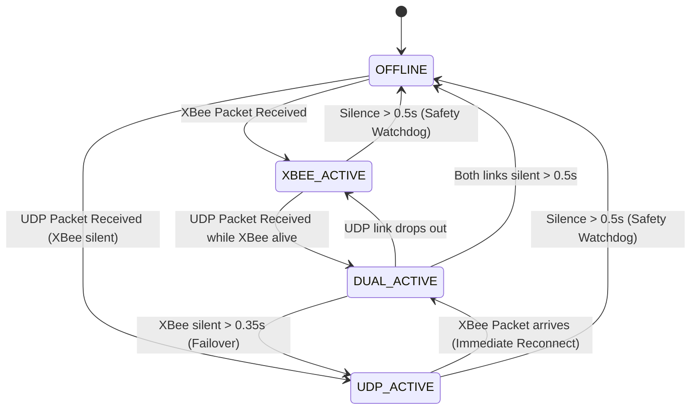

# Rover Telecommunications & Control Architecture

## 1. System Overview

This repository implements a **centralized, failure-proof, dual-redundant telecommunications and control architecture** for an autonomous/teleoperated planetary-style rover and its base station.

The architecture solves critical issues inherent in multi-script robotics communications:
- **Port Contention**: Physical serial radios (XBee 900MHz) are owned by **exactly one master process** on each side.
- **Head-of-Line (HoL) Blocking**: High-priority teleoperation packets preempt large RTCM3 differential GPS correction bursts.
- **Dual Redundancy with XBee Priority**: Teleoperation and RTCM corrections are transmitted concurrently across **both 900MHz XBee DigiMesh RF and Wi-Fi UDP**.
- **Latency & Out-of-Order Rejection**: RFC 1982 circular sequence number arithmetic prevents delayed or out-of-order packets from executing.
- **Duplicate Suppression**: Redundant command packets and duplicate RTCM GPS frames are filtered before reaching motor controllers or GPS hardware.

---

## 2. End-to-End System Topology

```mermaid
flowchart TD
    subgraph BASE["BASE STATION (Operator PC)"]
        direction TB
        JOY["Gamepad Teleop GUI\n(xbee_teleop_windows.py)"]
        GPS_BASE["Base GPS Survey-In\n(base_station_windows.py)"]
        GUI_DASH["React Web Dashboard\n(Vite + React 18)"]
        GUI_BACKEND["GUI Backend Service\n(FastAPI / WebSocket :8765)"]

        BASE_MASTER["BASE MASTER SCRIPT\n(base_master.py)\n*Sole Base XBee Owner*"]

        JOY -->|UDP :9001 (16B 'M' Motion)| BASE_MASTER
        GPS_BASE -->|UDP :9002 (Raw RTCM3 0xD3)| BASE_MASTER
        BASE_MASTER -->|UDP :9003 (Telemetry 'T' + ACKs)| GUI_BACKEND
        GUI_BACKEND <-->|WebSocket :8765| GUI_DASH
    end

    subgraph TRANSPORT["DUAL WIRELESS TRANSPORT LAYER"]
        direction LR
        RF_LINK["PRIMARY LINK\n900MHz DigiMesh RF (API 0x10 / 0x90)\n*Baud: 115200 | Non-blocking | Zero-ACK*"]
        WIFI_LINK["BACKUP / HIGH-BANDWIDTH LINK\nWi-Fi UDP Datagrams (:8888)\n*Direct Socket | Sub-millisecond LAN Latency*"]
    end

    BASE_MASTER ==>|Serial Frame 0x10| RF_LINK
    BASE_MASTER -.->|UDP Broadcast :8888| WIFI_LINK

    subgraph ROVER["ONBOARD ROVER (ROS 2 Jazzy)"]
        direction TB
        ROV_MASTER["ROVER COMMS MASTER\n(xbee_teleop/rx_node)\n*Sole Rover XBee Owner & Failover Engine*"]
        GPS_NODE["gps_node\n(Quectel LC29H RTK Driver)"]
        TEL_NODE["telemetry_node\n(Sensor Aggregator)"]

        DRIVE["Drive Motors (/cmd_vel)"]
        ARM["Arm Actuators (/arm_vel)"]

        RF_LINK ==>|Serial Frame 0x90| ROV_MASTER
        WIFI_LINK -.->|UDP Listener :8888| ROV_MASTER

        ROV_MASTER -->|/cmd_vel (Twist)| DRIVE
        ROV_MASTER -->|/arm_vel (Float32MultiArray)| ARM
        ROV_MASTER -->|/rtcm (Deduplicated)| GPS_NODE
        GPS_NODE -->|/gps (NavSatFix)| TEL_NODE

        TEL_NODE -->|/telemetry_tx| ROV_MASTER
        TEL_NODE -.->|Wi-Fi UDP :9003| GUI_BACKEND
    end
```

---

## 3. Subsystem Breakdown

### 3.1 Base Station Subsystem

The Base Station runs on the operator's computer (Linux or Windows):

1. **Central Master Hub ([`base_master.py`](file:///home/rezwan/Desktop/rover_com/base_station/base_master.py))**:
   - Sole process that binds the physical XBee serial port (`TELEOP_XBEE_PORT`).
   - Listens on `UDP 9001` for 16-byte `'M'` motion commands from joystick scripts.
   - Listens on `UDP 9002` for binary RTCM3 frames from the LC29H(BS) base station GPS.
   - Forwards telemetry (`'T'`) and ACK (`'A'`) datagrams to `UDP 9003`.
   - **Simultaneous Dual Transmission**: When a joystick packet or RTCM frame arrives, it transmits immediately over **both** XBee serial and Wi-Fi UDP port `8888`.
   - **Strict Teleop Priority**: Teleoperation packets preempt RTCM chunks. RTCM3 frames are sliced into chunks $\le 256$ bytes to eliminate Head-of-Line delay.

2. **Operator Teleop GUI ([`xbee_teleop_windows.py`](file:///home/rezwan/Desktop/rover_com/base_station/xbee_teleop_windows.py))**:
   - Reads Xbox / generic USB gamepads at 20 Hz.
   - Encodes linear velocity (`vx`), angular velocity (`wz`), and 5-DOF arm actuators into a 16-byte fixed-point `'M'` packet.
   - Defaults to `MASTER_HUB (UDP :9001)` mode while supporting standalone direct serial fallback.

3. **Base Station RTK GPS Survey-In ([`base_station_windows.py`](file:///home/rezwan/Desktop/rover_com/base_station/base_station_windows.py))**:
   - Communicates with the Quectel LC29H(BS) stationary module.
   - Performs survey-in (configurable duration, e.g., 300s, $\le 2.0$m accuracy).
   - Generates RTCM3 frames (1005, 1074, 1084, etc.) and transmits them to `UDP 9002`.

4. **Web Dashboard & Backend Engine ([`rover-gui`](file:///home/rezwan/Desktop/rover_com/base_station/rover-gui))**:
   - Backend ([`main.py`](file:///home/rezwan/Desktop/rover_com/base_station/rover-gui/backend/main.py)): Merges telemetry from XBee (UDP 9003) and direct Wi-Fi UDP, evaluates the active transport state (`DUAL_ACTIVE`, `XBEE`, `UDP`, or `OFFLINE`), and serves a WebSocket feed (`ws://localhost:8765`).
   - Frontend ([`ConnectionDiagnostics.tsx`](file:///home/rezwan/Desktop/rover_com/base_station/rover-gui/frontend/src/components/ConnectionDiagnostics.tsx)): Displays live channel status badges, XBee packet rates, LC29H RTK fix quality, and RTCM reception statistics.

---

### 3.2 Rover Onboard Subsystem (ROS 2 Jazzy)

1. **Rover Comms Master ([`rx_node.py`](file:///home/rezwan/Desktop/rover_com/rover/src/xbee_teleop_rover/xbee_teleop/rx_node.py))**:
   - Sole owner of the onboard XBee serial port (`/dev/rover_900mhz` or `/dev/ttyUSB0`).
   - Runs a background UDP socket thread bound to `0.0.0.0:8888`.
   - Executes the **Unified Dual-Redundant Packet Processor**:
     - Arbitrates priority between XBee RF and Wi-Fi UDP.
     - Performs RFC 1982 circular sequence math to drop stale out-of-order packets.
     - Deduplicates identical packets arriving over both channels.
     - Demultiplexes drive velocities to `/cmd_vel` (`geometry_msgs/Twist`).
     - Demultiplexes 5-DOF arm commands to `/arm_vel` (`std_msgs/Float32MultiArray`).
     - Demultiplexes deduplicated RTCM3 corrections to `/rtcm`.
   - Enforces a 0.5s deadman safety watchdog that zeroes motor commands if all links fail.

2. **Quectel LC29H RTK Driver ([`gps_node.py`](file:///home/rezwan/Desktop/rover_com/rover/src/rover-gps/src/gps_data/gps_data/gps_node.py))**:
   - Reads NMEA sentences from the GPS module on `/dev/rover_rtk`.
   - Subscribes to `/rtcm` and injects correction bytes into the module serial stream to attain RTK Fix / Float.
   - Publishes `sensor_msgs/NavSatFix` on `/gps`.

3. **Rover Telemetry Aggregator ([`telemetry_node.py`](file:///home/rezwan/Desktop/rover_com/rover/src/rover_telemetry/rover_telemetry/telemetry_node.py))**:
   - Collects GPS, IMU, battery, drive, and radio status at 5 Hz.
   - Transmits telemetry JSON back to the Base Station simultaneously over XBee downlink (`/telemetry_tx` $\rightarrow$ XBee 0x10) and Wi-Fi UDP (port 9003).

---

## 4. Dual-Redundancy & Priority Failover Engine

### 4.1 Link Priorities
- **Primary: 900MHz XBee DigiMesh RF**:
  - Provides long-range, non-line-of-sight penetration around obstacles.
  - Immune to 2.4GHz / 5.8GHz Wi-Fi congestion.
  - Must always take precedence when active.
- **Secondary: Wi-Fi UDP (Port 8888)**:
  - Low-latency, high-bandwidth connection when the rover is in Wi-Fi range.
  - Acts as an instant hot-standby if XBee RF is disrupted.

### 4.2 Failover & Recovery State Machine



### 4.3 Failover Timing Parameters
- **`XBEE_FAILOVER_TIMEOUT` = 0.35s**:
  - At 20 Hz transmission rate, 0.35s corresponds to 7 missed XBee packets.
  - If no XBee packet arrives within 0.35s, `xbee_alive` evaluates to `False`, allowing UDP commands to execute immediately.
- **`CMD_TIMEOUT` = 0.50s**:
  - If **both** XBee and UDP are silent for $>0.50$s, the deadman timer trips and publishes zeros on `/cmd_vel` and `/arm_vel`.
  - Because `0.35s < 0.50s`, failover from XBee to UDP occurs **without the motors ever zeroing or stuttering**.

---

## 5. Latency & Out-of-Order Packet Handling

### 5.1 The Problem
When packets are sent simultaneously across heterogeneous networks (Wi-Fi UDP vs. 900MHz Serial RF), transmission latencies differ:
- Wi-Fi UDP: 0.2 – 5.0 ms
- XBee 900MHz RF: 15 – 45 ms (serial buffering, RF modulation, DigiMesh hops)

If a Wi-Fi packet drops and later arrives via a retransmission or delayed queue, or if an RF packet is delayed in the radio's internal FIFO, an **older command could arrive after a newer command has already executed**. Executing an old packet would cause motion stutter or erratic control reversals.

### 5.2 The Solution: RFC 1982 Circular Sequence Number Arithmetic
The 16-byte `'M'` packet carries an 8-bit unsigned sequence number `seq` ($0 \dots 255$) that wraps every 256 packets ($\approx 12.8$ seconds at 20 Hz).

To determine if an incoming packet is newer, duplicate, or stale across wrap-around boundaries:

$$\Delta = (\text{seq} - \text{last\_executed\_seq}) \pmod{256}$$

```python
diff = (seq - self.last_executed_seq) & 0xFF

if diff == 0:
    # 1. DUPLICATE: Arrived via redundant channel -> discard
    self.duplicates_rejected += 1
    return

if diff >= 128:
    # 2. STALE / DELAYED: Older packet delayed by latency -> discard
    self.stale_rejected += 1
    return

# 3. NEWER PACKET (0 < diff < 128):
# Check channel priority: ignore UDP if XBee is currently alive
if source == 'UDP' and xbee_alive:
    return

# Accept and execute
self.last_executed_seq = seq
self.active_source = source
self.vx, self.wz = vx, wz
```

### 5.3 RTCM Deduplication
RTCM3 frames do not feature sequence counters. The rover comms master maintains a 64-element rolling hash buffer (`hash(data[:32])`). When duplicate RTCM correction frames arrive across both XBee and UDP, only the first unique frame is forwarded to `/rtcm`, preventing serial buffer overruns on the LC29H GPS module.

---

## 6. Packet Protocol Specifications

### 6.1 Unified MOTION Packet (`'M'`, 16 Bytes)
Transmitted at 20 Hz. Carries drive and 5-DOF arm commands in a single fixed-point little-endian struct (`<cBhhhhhhh`).

| Byte Offset | Field | Data Type | Encoding / Units | Description |
|---|---|---|---|---|
| `0` | Header | `char` | ASCII `'M'` (`0x4D`) | Packet identifier |
| `1` | Sequence | `uint8` | $0 \dots 255$ | Circular rolling packet sequence |
| `2 - 3` | `linear_x` | `int16` | $\text{real\_value} \times 1000$ | Linear velocity $v_x$ (m/s) |
| `4 - 5` | `angular_z` | `int16` | $\text{real\_value} \times 1000$ | Angular velocity $\omega_z$ (rad/s) |
| `6 - 7` | `act1` | `int16` | $\text{real\_value} \times 1000$ | Arm Actuator 1 (-1.0 to +1.0) |
| `8 - 9` | `act2` | `int16` | $\text{real\_value} \times 1000$ | Arm Actuator 2 (-1.0 to +1.0) |
| `10 - 11` | `act3` | `int16` | $\text{real\_value} \times 1000$ | Arm Actuator 3 (-1.0 to +1.0) |
| `12 - 13` | `wrist` | `int16` | $\text{real\_value} \times 1000$ | Wrist Stepper (-1.0 to +1.0) |
| `14 - 15` | `gripper` | `int16` | $\text{real\_value} \times 1000$ | Gripper Motor (-1.0 to +1.0) |

### 6.2 Low-Latency XBee API Framing (Type 0x10)
Serial frames are formatted in Digi XBee API Mode 1 without hardware ACK overhead:
- **`0x7E`**: Start delimiter
- **Length**: 2 bytes (Big-Endian)
- **`0x10`**: Transmit Request
- **`0x00`**: Frame ID (disables `0x8B` status callbacks, removing serial queue congestion)
- **`64-bit Address`**: 8 bytes (target radio address or `00..FFFF` broadcast)
- **`0xFF 0xFE`**: 16-bit network address
- **`0x00`**: Broadcast radius
- **`0x01`**: Transmit options (**Disable RF MAC ACKs** — eliminates 20 Hz loop stutter)
- **RF Data**: 16-byte `'M'` payload or $\le 256$-byte RTCM chunk
- **Checksum**: 1 byte (`0xFF - (sum & 0xFF)`)

### 6.3 Rover ACK Packet (`'A'`, 5 Bytes)
Rover transmits diagnostic ACK frames at 2 Hz back to the Base Station (`<cBH`):
- `Offset 0`: `'A'` (`0x41`)
- `Offset 1`: `last_seq` (`uint8`) — last executed sequence number
- `Offset 2-3`: `lost` (`uint16`) — cumulative lost packet count

### 6.4 Rover Telemetry Packet (`'T'`, Variable JSON)
Broadcast at 5 Hz over Wi-Fi UDP and XBee radio. Contains aggregated sensors:
```json
{
  "timestamp": "2026-11-18T08:20:42.123456",
  "battery": {"voltage": 25.4, "percentage": 88.0},
  "gps": {"latitude": 23.8103, "longitude": 90.4125, "fix_quality": 4, "satellites": 18},
  "connection": {
    "channel": "DUAL_ACTIVE",
    "xbee_connected": true,
    "gps_connected": true,
    "gps_fix": "RTK FIXED",
    "rtcm_received": true,
    "rtcm_count": 1420,
    "rtcm_age_s": 0.3
  }
}
```

---

## 7. Single Source of Truth Configuration

All hardware ports, IP addresses, UDP ports, and protocol timeouts are defined in two mirror configuration files:
- **Base Station**: [`base_station/comms_config.py`](file:///home/rezwan/Desktop/rover_com/base_station/comms_config.py)
- **Rover Onboard**: [`rover/src/comms_config.py`](file:///home/rezwan/Desktop/rover_com/rover/src/comms_config.py)

Key parameters:
```python
# Network Uplink (Base Station -> Rover)
ROVER_IP                = '127.0.0.1'    # Change to Rover LAN IP in field
ROVER_UDP_LISTEN_PORT   = 8888           # Dual-redundancy Wi-Fi UDP port
DUAL_REDUNDANCY_ENABLED = True           # Master broadcast switch
XBEE_FAILOVER_TIMEOUT   = 0.35           # Seconds before UDP failover

# Base Station UDP Hub
UDP_JOY_PORT            = 9001           # Joystick -> Base Master
UDP_RTCM_PORT           = 9002           # Base GPS -> Base Master
UDP_STATUS_PORT         = 9003           # Telemetry/ACK -> Base GUI
RTCM_CHUNK_MAX          = 256            # Max RTCM frame slice size
```

---

## 8. Failure Modes & Mitigations

| Failure Mode | Impact | Architectural Mitigation |
|---|---|---|
| **XBee Radio RF Loss** (Out of range / blockage) | Teleoperation commands drop | **Instant UDP Failover**: Rover switches to Wi-Fi UDP within 0.35s without zeroing motor velocities. |
| **Wi-Fi Dropped** (Distance / interference) | High-bandwidth feed lost | **XBee Priority Lifeline**: Teleop and RTCM continue unimpeded over 900MHz DigiMesh RF. |
| **Out-of-Order Packet Arrival** (Network jitter) | Rover reverses or twitches | **RFC 1982 Sequence Math**: Rover checks `(seq - last) & 0xFF`; stale packets ($\Delta \ge 128$) are discarded. |
| **Redundant Channel Packet Duplication** | High rate duplicate execution | **Sequence Equality Check**: `diff == 0` discards duplicate frames arriving across the secondary link. |
| **RTCM Frame Flooding** | Teleop loop latency spike | **Preemption & Slicing**: Teleop packets preempt RTCM. RTCM frames are sliced to $\le 256$ bytes. |
| **Total Signal Loss** (Both links fail) | Runaway rover risk | **0.5s Safety Watchdog**: If no valid packet arrives on either link for 0.5s, all drive and arm velocities are zeroed. |
| **USB Disconnect / Device Replug** | Serial process crash | **Non-blocking Serial Watchdog**: Master scripts catch serial exceptions, enter non-blocking retry loops, and reconnect automatically. |

---

## 9. Verification & Test Suite

The architecture is verified with automated tests in `scratch/`:

1. **[`scratch/test_dual_redundancy_and_latency.py`](file:///home/rezwan/Desktop/rover_com/scratch/test_dual_redundancy_and_latency.py)**:
   - **Phase 1**: Concurrent transmission verifies XBee commands execute and UDP commands are ignored.
   - **Phase 2**: Complete XBee cut verifies seamless failover to UDP within 0.35s without velocity drop.
   - **Phase 3**: XBee resumption verifies immediate preemption back to XBee.
   - **Phase 4**: Injection of delayed sequence 30 while at sequence 65 verifies stale packet rejection and duplicate rejection.
   - **Phase 5**: Simultaneous RTCM transmission verifies content hash deduplication.
2. **[`scratch/test_centralized_comms.py`](file:///home/rezwan/Desktop/rover_com/scratch/test_centralized_comms.py)**:
   - Verifies priority queuing, virtual serial routing, `/cmd_vel`, `/arm_vel`, `/rtcm`, and safety watchdog zeroing.
